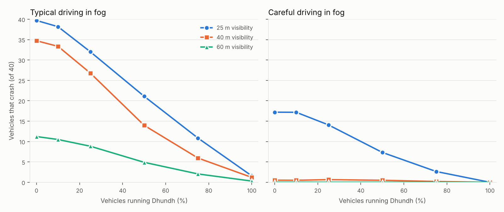

# Dhundh धुंध

Dhundh ("fog") turns phones into vehicle-to-vehicle radios. When a car brakes hard, stops on a fast road or crashes, the phone on its dashboard broadcasts a signed warning over long-range Bluetooth. Phones in the cars behind hear it, pass it further back, and warn their drivers before the hazard comes out of the fog. No internet, no towers, no new hardware.

## Why

Every winter, dense fog on North Indian expressways causes chain collisions. In December 2025, a pile-up of buses and cars on the Delhi–Agra Expressway near Mathura killed 13 people. In fog, the driver in front knows they have braked. The drivers behind find out when they can see the brake lights, which is often too late to stop.

Vehicle-to-vehicle radio (C-V2X, DSRC) solves exactly this, and almost no vehicle on Indian roads has one. Almost every driver has a phone with Bluetooth 5.

## How it works

1. **Sensing.** The phone watches GNSS speed and its own accelerometer. Hard braking needs both to agree (speed falling at 4 m/s² or more, and a matching horizontal jolt), because either alone is easy to fool: GNSS jumps under bridges and potholes shake the phone. A stop on a road where we were just doing more than 43 km/h counts as a stopped vehicle. A spike above 4 g counts as a crash.
2. **Broadcast.** A 119-byte warning (type, GNSS time, position, course, speed, deceleration) is signed with Ed25519 and sent as a Bluetooth LE extended advertisement on the long-range Coded PHY, ten times a second for three seconds. No pairing and no connection.
3. **Relay.** Every phone that hears a fresh warning passes it on once, up to four hops, so it travels back along a queue far beyond one radio range. Relays can change only the hop count; the original signature still has to verify.
4. **Relevance.** A phone alerts its driver only if the hazard is ahead (within 35° of our course), was reported by a vehicle going our way (so braking on the other carriageway is ignored), is fresh, and we would reach it within 30 seconds. Under 10 seconds or 60 metres it is urgent: alarm tone, vibration and a spoken distance.

Details: [protocol](docs/protocol.md), [what the signatures do and do not protect](docs/threat-model.md).

## Would it help? A simulation

`sim/fogsim.py` models a 40-vehicle queue on an expressway lane driving towards a stopped car in fog. Drivers follow the Intelligent Driver Model with human reaction delays and anticipation (the Human Driver Model): they react to every vehicle they can see within the visibility distance and drive at their own chosen speed when they can see nothing. A quarter of the vehicles are trucks or buses that brake less hard. Phones running Dhundh warn as described above; alerted drivers react after 1.2 seconds and slow down for the reported hazard.



Mean number of vehicles out of 40 that crash, over 40 random queues per cell:

| Typical driving in fog | 0% | 10% | 25% | 50% | 75% | 100% |
|---|---:|---:|---:|---:|---:|---:|
| 25 m visibility | 39.7 | 38.2 | 32.0 | 21.1 | 10.8 | 1.6 |
| 40 m visibility | 34.7 | 33.4 | 26.8 | 14.0 | 6.0 | 1.2 |
| 60 m visibility | 11.2 | 10.5 | 8.8 | 4.9 | 2.0 | 0.3 |

| Careful driving in fog | 0% | 10% | 25% | 50% | 75% | 100% |
|---|---:|---:|---:|---:|---:|---:|
| 25 m visibility | 17.2 | 17.2 | 14.1 | 7.3 | 2.6 | 0.0 |
| 40 m visibility | 0.5 | 0.5 | 0.7 | 0.5 | 0.2 | 0.0 |
| 60 m visibility | 0.0 | 0.0 | 0.0 | 0.0 | 0.0 | 0.0 |

"Typical" drivers keep 0.6 to 1.6 second gaps, drive at 55 to 95 km/h and react in 1 to 2 seconds; "careful" drivers keep 1.2 to 2.5 seconds, drive at 40 to 70 km/h and react in 0.8 to 1.5 seconds. In clear weather neither profile crashes at all in this model.

What to take from this, and what not to:

* It is a model, not a forecast. The driver profiles are not calibrated to Indian crash data, and the radio is assumed to reach 300 m with 0.4 s per hop.
* The benefit grows with adoption, as any network does: 10% adoption barely helps, half the vehicles roughly halves the crashes in dense fog.
* Vehicles without the app still benefit, because warned cars ahead of them slow down earlier.
* The real unknown is the radio: phone-to-phone range and delay inside moving vehicles. That is what the field test measures.

Run it yourself: `cd sim && python run_sweep.py --runs 40`.

## Status

| Part | State |
|---|---|
| `core/` protocol, signatures, relevance, brake detection, replay and flood protection | Built, 8 tests pass (`javac` + `java`, no dependencies) |
| `sim/` fog pile-up simulator | Built, 5 tests pass, results above |
| `app/` Android app | Written; first device build and field test under way |
| Field test: range, delay, relays, battery | Planned, see [docs/field-test.md](docs/field-test.md) |

## Build

```bash
./gradlew :core:test          # core tests
./gradlew :app:assembleDebug  # Android app, needs the Android SDK
cd sim && pytest -q           # simulator tests
```

Without Gradle, the core tests run with just a JDK:

```bash
javac -d build core/src/main/java/org/dhundh/core/*.java core/src/test/java/org/dhundh/core/*.java
java -cp build org.dhundh.core.CoreTests
```

## Limits

* Android only. iOS does not let apps send Bluetooth extended advertisements.
* Phones without Bluetooth 5 Coded PHY reach less far; phones without extended advertising can hear warnings but not send them.
* It warns; it never brakes or steers. A false warning costs attention, not control. If warnings ever drive automatic braking, anonymous keys are not enough (see the threat model).
* Drivers must not handle the phone while driving. Dhundh is meant to be started before the trip and heard, not looked at.

## Licence

Apache-2.0.
